  

 

  
  
  
  
  

 

###  &nbsp;Profile Overview

I am **Frankie Steinlie**, a Software Engineer and IT Instructor based in **Surabaya, Indonesia**. I focus on engineering reliable software architectures that bridge complex data workflows with clean, high-utility user interfaces.

* **Core Engineering:** Building full-stack web ecosystems, offline-first Progressive Web Apps (PWA), and cross-platform mobile applications.
* **Applied Data Science:** Designing time-series forecasting pipelines and spatial GIS monitoring platforms for operational decision-making.
* **Technical Mentorship:** Guiding developers and students in software architecture, database modeling, and modern web standards.

 

###  &nbsp;Selected Architecture & Systems

| System | Domain & Impact | Core Stack |
| :--- | :--- | :--- |
| **Sikarta GIS Platform** | Offline-first Progressive Web App for spatial incident mapping and field coordination with automated background sync. | `Laravel` `Vue.js` `Leaflet GIS` `PWA` |
| **Enterprise E-Learning Suite** | Automated learning management platform featuring progress tracking, attendance analytics, and dynamic PDF certificate generation. | `Laravel` `MySQL` `JavaScript` `REST API` |
| **Logistics Demand Forecasting** | Time-series predictive modeling engine to optimize regional package distribution and resource allocation. | `Python` `Prophet` `Pandas` `Jupyter` |

 

###  &nbsp;Technology Stack

<table>
  <tr>
    <td width="190"><strong>Frontend & Mobile</strong></td>
    <td width="690">
      
      
      
      
      
    </td>
  </tr>
  <tr>
    <td><strong>Backend & APIs</strong></td>
    <td>
      
      
      
      
    </td>
  </tr>
  <tr>
    <td><strong>Data & Infrastructure</strong></td>
    <td>
      
      
      
      
    </td>
  </tr>
</table>

 

###  &nbsp;Engineering Metrics

  
  

